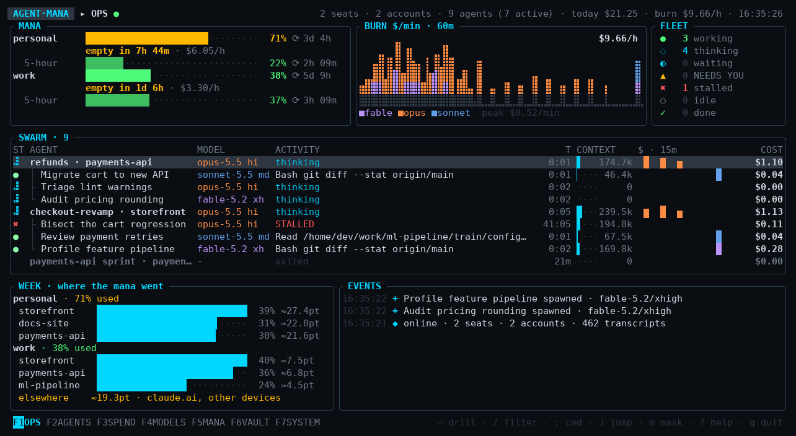
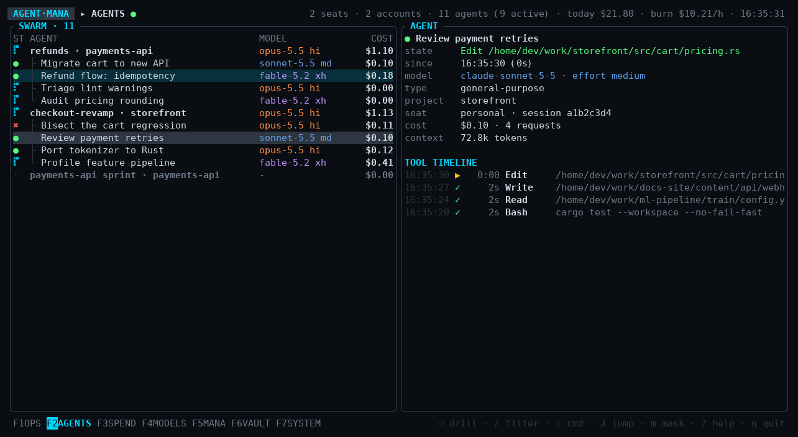
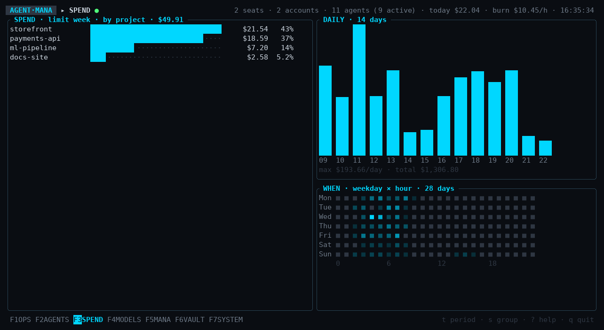
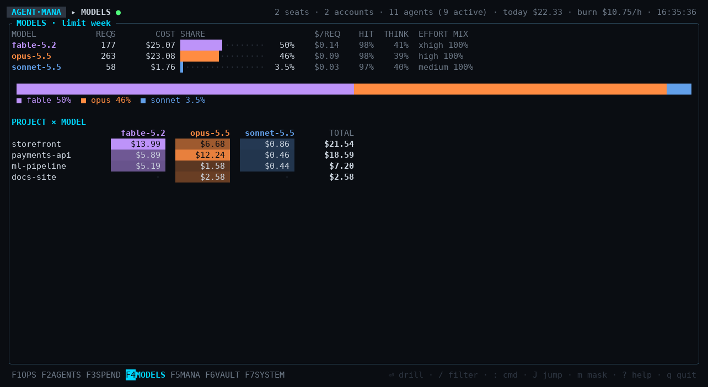
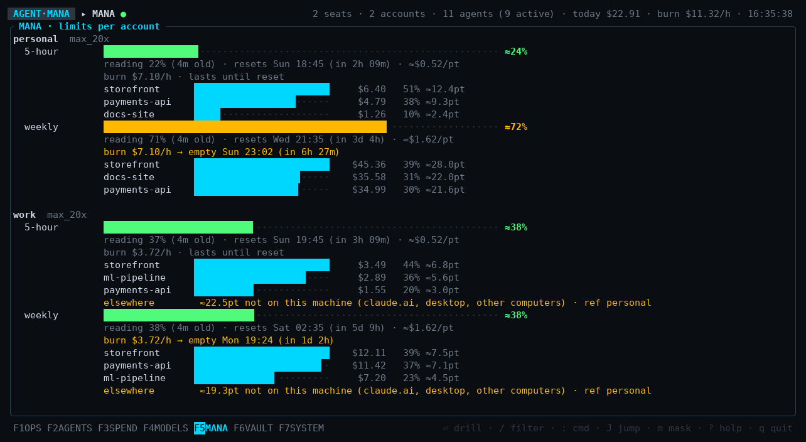
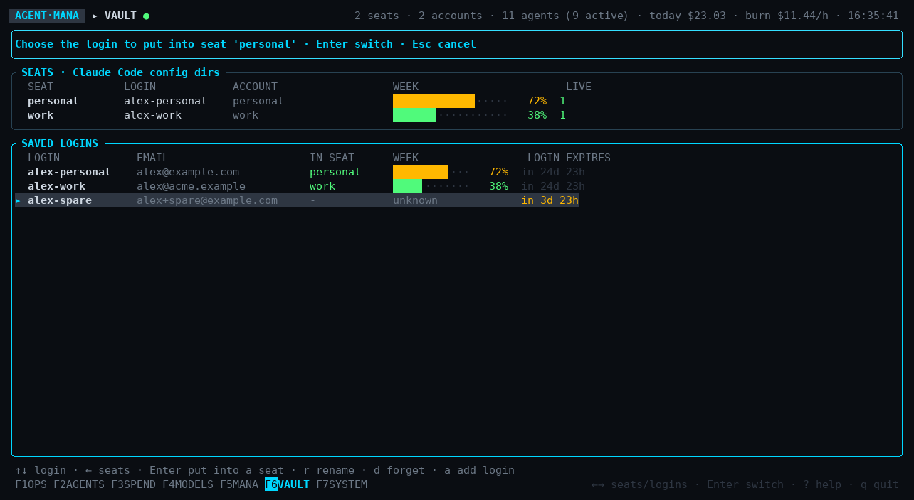

# agentmana

Mission control for Claude Code agents, in your terminal.


Run several Claude Code instances (with different `CLAUDE_CONFIG_DIR`s), each with dozens of
subagents, and see in one place:

- **what every agent is doing right now** — thinking, running `cargo test`, waiting for you,
  waiting for its children, stalled — as a live tree, with timers, context fill and cost tickers;
- **what it would cost at API prices**, by project, account, model, agent type, session, day;
- **where your weekly limit went**, in % per project, and **when it will run out** at the current
  burn rate;
- **how each model is used** (Opus, Fable, Sonnet, Haiku): cost share, cache hits, thinking, effort
  mix, requested-vs-served substitutions;
- **CPU, RAM and disk** taken by the agents and their child processes.

It also keeps a **vault of OAuth logins**: save the login of a config dir, put another account's
login into it when the limit runs out, and switch back later, without losing tokens.

Everything is read from what Claude Code already writes to disk. Nothing leaves your machine.

## Screens

| | |
|---|---|
|  **OPS** — limits, burn rate, the live agent tree, where the week went |  **AGENTS** — any agent's state, model, cost, context and tool timeline |
|  **SPEND** — by project / model / agent type / account, daily bars, weekday × hour heatmap |  **MODELS** — cost share, cache hits, thinking, effort mix, project × model |
|  **MANA** — each account's 5-hour and weekly window, ETA, shares, usage elsewhere |  **VAULT** — saved logins and seats; pick, switch, save, rename from the keyboard |

Try it without touching your own data:

```sh
agentmana demo
```

## Install

```sh
cargo install --path .
```

Optionally give it a short name (packages ship only `agentmana`, because `am` collides with other
tools):

```sh
agentmana shell-alias          # adds `alias am=agentmana` to your shell rc
```

## Use

```sh
agentmana                       # the live dashboard
agentmana limits                # weekly / 5-hour limits: shares per project, ETA
agentmana report --by project   # spend; --by account|seat|model|effort|agent-type|session|agent|day|hour|weekday
agentmana report -p 30d --by day --format csv
agentmana models -p 7d          # per-model statistics
agentmana accounts              # seats, saved logins, limit left on each
agentmana doctor                # what was found and whether it is readable
agentmana prices                # the price in force for every model and its source
```

Periods: `today`, `yesterday`, `week` (the current limit window), `month`, `all`, `24h`, `7d`,
`YYYY-MM-DD`, `FROM..TO`. Every report takes `--account`, `--seat`, `--project`, `--model` filters
and `--format table|json|csv`. `--mask` hides emails, names and full paths (for screenshots).

### The dashboard

| Key | Action |
|---|---|
| `F1`–`F7`, `1`–`7`, `Tab` | OPS · AGENTS · SPEND · MODELS · MANA · VAULT · SYSTEM |
| `↑↓` / `j k` | select an agent; `Enter` for details and its tool timeline |
| `J` | jump to the agent's Claude Code in tmux |
| `/` | filter agents |
| `:` | command: `switch <seat> <login>`, `capture <seat> [label]`, `period 7d`, `theme amber` |
| `t` / `s` | cycle period / grouping (SPEND) |
| `m` · `p` · `T` | mask · pause animations · theme (ops, phosphor, amber, plain) |
| VAULT: `←→` `↑↓` `Enter` | pick a seat and a login to put into it (or a login, then its seat) |
| VAULT: `c` · `a` · `r` · `d` | save the selected seat's login · log into a new account · rename · forget |
| `?` · `q` | help · quit |

### Light on the battery

The dashboard redraws at 10 frames a second only while something animates and reads only the
transcripts of running sessions every second; the full scan runs once a minute, history charts
every five minutes, the full process table only on the SYSTEM screen. On a busy machine it uses
about 1 CPU-second per minute (under 2% of one core). On battery (Linux, macOS) or with `--eco` it
drops to 4 frames and a refresh every 3 seconds.

## How the numbers are made

- **Cost** is API-equivalent: every response's tokens (input, 5-minute and 1-hour cache writes,
  cache reads, output, web searches) times the list price of its model. Claude Code writes one
  transcript record per content block, all with the same usage, so responses are de-duplicated by
  message id. Prices are versioned data: built-in, overridden by the table Claude Code itself
  caches, overridden by your `config.toml`. Models without a price are flagged, never silently $0.
  Background calls Claude Code makes without a transcript record (titles, summaries) are missing;
  `doctor` compares the totals with Claude Code's own counter (typically within 1%).
- **Limits** come from the utilization Claude Code caches (`/usage`), per account. Spend inside the
  window is split by project; the limit points of a project are its share of the utilization.
  Utilization also counts claude.ai, the desktop app and other computers, which leave no trace
  here: when two accounts share a plan, the one with the most dollars per point is the reference,
  and the gap on the others is shown as *elsewhere*. All of this is an estimate (≈): how Anthropic
  meters limits is not public.
- **Limit resets.** When a limit is reset early (Claude Code's limit reset), utilization falls
  while the window is still open; agentmana notices the fall between two readings and counts the
  window from there.
- **Accounts** are tracked per request (`session-owner` records), so seats logged into the same
  account share one limit, and switching logins does not mix the books.
- **Projects** are git repositories; worktrees count towards the repository they belong to.

## The vault

```sh
agentmana accounts capture work --label alice      # save the login of seat "work"
agentmana accounts add --label bob                 # log into another account in a scratch seat
agentmana accounts switch work bob                 # put bob into seat "work"
agentmana accounts switch work alice               # and back
agentmana accounts import old-backup.json --label carol
```

A switch first saves whatever the seat holds — a login that is not in the vault yet is saved
automatically under the seat's name, so switching never loses a token — then backs up both files,
writes `claudeAiOauth` atomically while keeping the seat's MCP tokens, and restores the account
shown by Claude Code. One login is never mounted in two seats unless you insist (`--share`).

The vault follows the seats on its own. Claude Code refreshes the access token every few hours and
keeps the refresh token: the saved copy just takes the new access token. A different refresh token
means another login (a `/login`, a copied backup): the saved login is left untouched, the seat is
shown as *not saved*, and — until Claude Code re-reads the profile in that seat — its account as
*unconfirmed*, so it is not mixed up with the account the stale profile names. In the dashboard the
VAULT screen updates as soon as a login file changes; `R` forces a re-read.

Secrets are kept in `~/.local/share/agentmana/vault/secrets.json` with mode 0600 — the same
protection Claude Code gives the same tokens in `.credentials.json`. On macOS, where Claude Code
keeps the login in the Keychain, the vault cannot switch logins yet.

Use it with your own accounts, within your provider's terms.

## Privacy

- No network access, no telemetry.
- Claude Code's directories are only read. The only write is an explicit `accounts switch`.
- The index lives in `~/.local/share/agentmana/` (macOS: `~/Library/Application Support/agentmana`).

## Configuration

Optional, `~/.config/agentmana/config.toml`:

```toml
stall_minutes = 20                 # unfinished agent with no activity this long = stalled
theme = "ops"                      # ops | phosphor | amber | plain

[[seat]]                           # config dirs that are not ~/.claude or ~/.claude-*
path = "~/agents/cc-work"
label = "work"

[[project]]                        # paths that moved or come from another machine
match = "/home/user/work/old-name"
name = "shop"

[[price]]                          # USD per million tokens
model = "claude-opus-5-5"
from = "2026-12-01"
input = 4
output = 20

[accounts]                         # display names
"<account uuid>" = "personal"
```

## Status

Early. Linux is the main target; macOS and Windows builds, static binaries and packages
(deb, rpm, Homebrew, AUR, Nix, winget, Scoop) are on the roadmap.

## License

MIT OR Apache-2.0, at your option: see LICENSE-MIT and LICENSE-APACHE.
