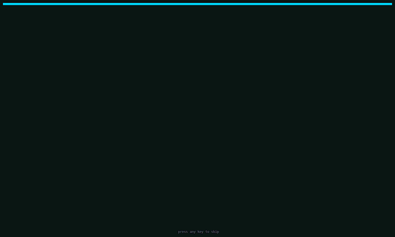
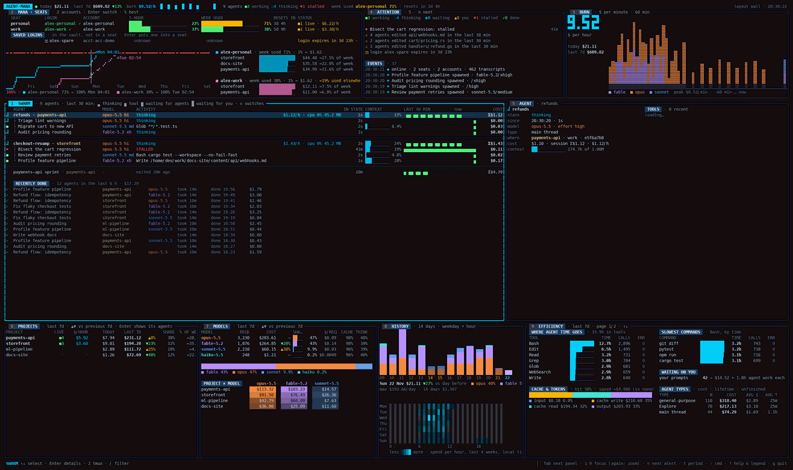
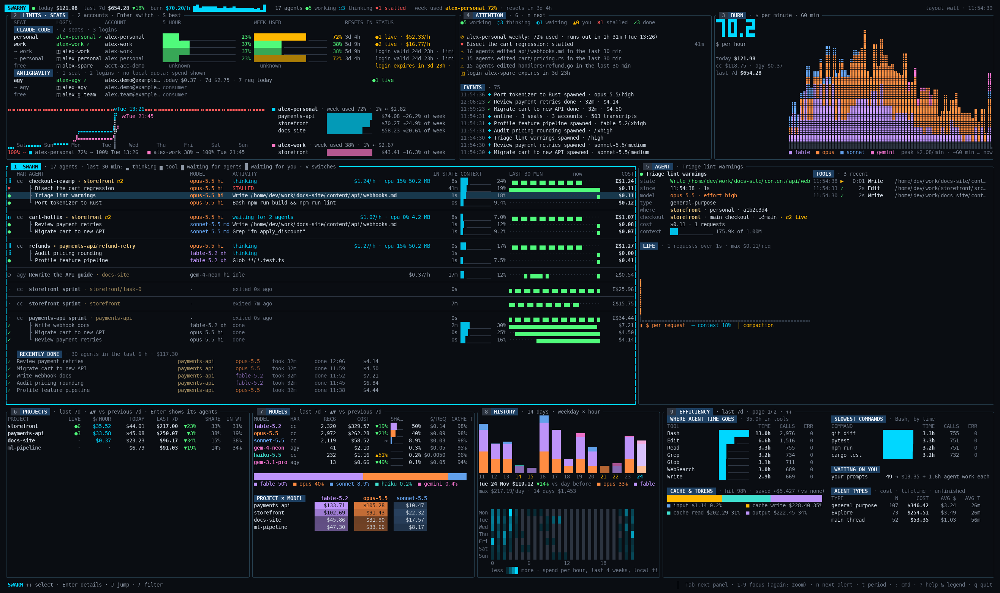
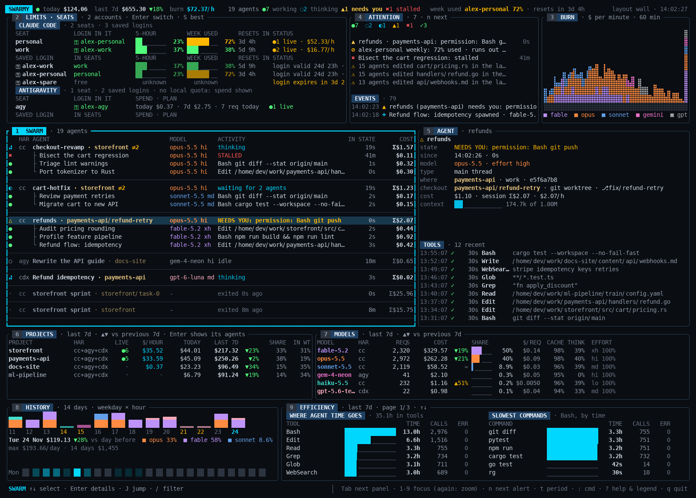
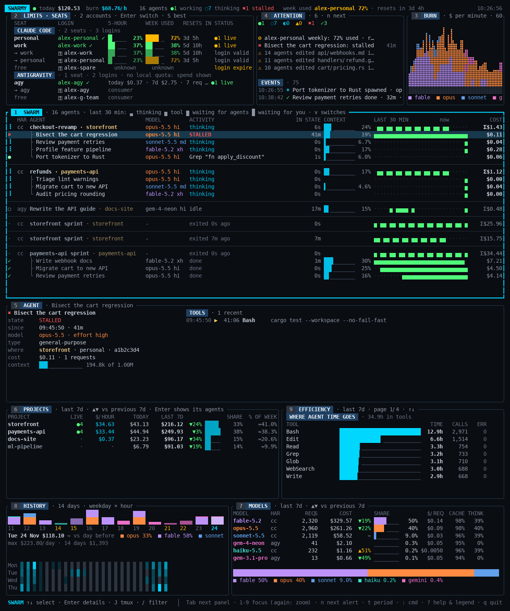
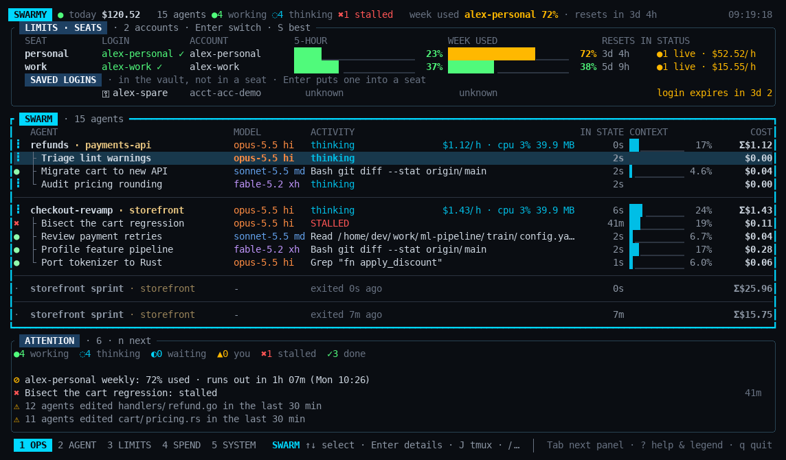
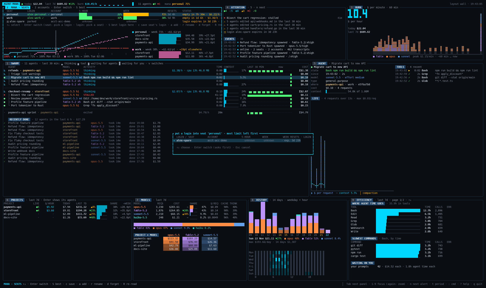

# swarmy

Mission control for Claude Code agents, in your terminal.





Run several Claude Code instances (with different `CLAUDE_CONFIG_DIR`s), each with dozens of
subagents, and see in one place:

- **dozens of agents across all your Claude Code sessions at once** — what each one is doing right
  now (thinking, running `cargo test`, waiting for its children, stalled), as a live tree with
  30-minute activity lanes, timers, context fill and cost;
- **the moment an agent needs you** — a question, a permission, a plan to approve: it blinks in
  the tree, rings the terminal bell, goes to the top of ATTENTION, and `n` selects it;
- **one key to get there** — `J` switches your tmux client to the pane where that Claude Code
  runs (Claude Code records its tmux pane; swarmy selects that window and pane and switches the
  client to its session), so you answer and come back;
- **what it would cost at API prices**, by project, account, model, agent type, session, day;
- **where your weekly limit went**, in % per project, and **when it will run out** at the current
  burn rate — also when you swap logins between config dirs or reset a limit by hand;
- **how each model is used** (Opus, Fable, Sonnet, Haiku): cost share, cache hits, thinking, effort
  mix, requested-vs-served substitutions;
- **CPU, RAM and disk** taken by the agents and their child processes.

It also keeps a **vault of OAuth logins**: save the login of a config dir, put another account's
login into it when the limit runs out, and switch back later, without losing tokens.

Everything is read from what Claude Code already writes to disk. Nothing leaves your machine.

## Screens

On a big terminal everything is on one wall; nothing hides behind tabs.



| | |
|---|---|
|  **A smaller screen (200×60)** — every panel still on screen, the bottom ones in two rows; zoom (`z`) any of them |  **Half a screen (160×81)** — the same panels stacked |
|  **A laptop terminal (140×34)** — the panels grouped into five tabs |  **Switching a login** — Enter on a seat lists the saved logins, the one with the most limit left first | |

The panels:

- **1 SWARM** — live agents grouped by session (sessions are separated, project names stand out), each with a 30-minute activity lane (thinking · tool · waiting for agents · waiting for you; `v` switches to spend), then what finished recently
- **2 LIMITS · SEATS** — how much of each account's weekly limit is used ("week used", "runs out in …"), seats, and the saved logins of the vault; under them the week as a curve per account with real readings, the projection to the reset and the 100% line, and where each account's week went
- **3 BURN** — dollars per hour and per minute by model
- **4 ATTENTION** — needs you, stalled, limits about to run out, two agents editing one file, unsaved or expiring logins; the event log under it (filled from the last 3 hours on launch)
- **5 AGENT** — card, last message, the agent's life (cost of each request, context growth, compactions), tool timeline
- **6 PROJECTS** — live agents, $/hour, today, the period with ▲▼ against the previous one, share of the week
- **7 MODELS** — spend, trends, cache, thinking, effort, project × model
- **8 HISTORY** — 14 days stacked by model (`←→` picks a day), weekday × hour heat map
- **9 EFFICIENCY** — where agent time goes (tools, slowest commands), how long agents waited for you, what a prompt costs, cache savings and the token cost split, agent types, fleet size over 24 h, rate limits, compactions, file conflicts, subscription value (with `[subscription]` in the config)
- **0 SYSTEM** — Claude Code processes, CPU, RAM, disk

Try it without touching your own data:

```sh
swarmy demo
```

## Install

```sh
cargo install --path .
swarmy setup        # optional, see below
```

### Optional: `swarmy setup` and the status line

swarmy works as it is: it reads what Claude Code writes. `swarmy setup` is an optional wizard that
makes two things better:

1. **Exact limits, after every response.** Without it, the limit percentage comes from the reading
   Claude Code caches now and then, and swarmy estimates in between (`≈`); a limit reset shows up
   only with the next reading. Claude Code's *status line* receives the real numbers with every
   response, so setup adds the swarmy status line to each seat's `settings.json`:

   ```json
   "statusLine": { "type": "command", "command": "/path/to/swarmy statusline" }
   ```

   Claude Code then shows under its prompt (here with the dashboard running):

   ```
   ▲ 2 need you: shop-api, docs · swarmy n J │ ◐ 3 agents ●2 ◌1 │ week used 38% · runs out in 7h (Mon 03:34) │ 5h 12% │ ctx 42% │ $4.20 │ $3.1/h
   ```

   - **▲ who needs you** in your *other* sessions, in every Claude Code window, with the way
     there: `swarmy` then `n` and `J`, or `swarmy jump` (bind it to a tmux key:
     `bind-key y run-shell "swarmy jump"`). Without the dashboard running, the status line still
     finds them in Claude Code's session registry.
   - **◐ this session's agents** and their states, **this account's week** (exact, from Claude
     Code) and when it runs out at the current pace, the 5-hour window, context fill, the
     session's cost and its dollars per hour.
   - On a narrow terminal pieces go in this order: $/h, cost, 5h (unless past 60%), times, agent
     details, names; context stays past 70%; "needs you" and the week never go.
   - The dashboard writes a small summary for it (`statusline/fleet.json`, mode 0600, every few
     seconds when something changed); the status line itself only reads files and takes a few
     milliseconds.

   swarmy also keeps each limit reading (in its own data dir; no network, nothing else changes),
   so the dashboard's limits are exact too. A status line you already have is kept and shown first
   (`swarmy statusline --then '<your command>'`). Setup also sets `refreshInterval` (10 s), so a
   session that sits idle still learns that another one needs you. Every changed `settings.json`
   is backed up next to it (`settings.json.swarmy-<time>.bak`).

   Tune it in `~/.config/swarmy/config.toml`:

   ```toml
   [statusline]
   segments = ["attention", "agents", "week", "five_hour", "context", "cost", "burn"]
   lines = 2              # a second line: model and effort, git branch, session name, cold cache
   refresh_seconds = 10   # written into Claude Code's refreshInterval by `swarmy setup`
   reserve = 0            # columns kept free for Claude Code's own notifications
   mask = false           # hide session names (also SWARMY_MASK=1), e.g. for screen sharing
   ```

2. **Saved logins**, so a seat can take another account's login when a limit runs out and switch
   back later.

```sh
swarmy setup              # asks before each change
swarmy setup --yes        # no questions
swarmy setup --no-vault   # only the status line
swarmy setup --remove     # take the status line out again (restores the one it wrapped)
```

To do it by hand, add the `statusLine` above to `~/.claude/settings.json` (and to the
`settings.json` of every other config dir). `swarmy doctor` says which seats have it.


## Use

```sh
swarmy                       # the live dashboard
swarmy limits                # weekly / 5-hour limits: shares per project, ETA
swarmy report --by project   # spend; --by account|seat|model|effort|agent-type|session|agent|day|hour|weekday
swarmy report -p 30d --by day --format csv
swarmy models -p 7d          # per-model statistics
swarmy accounts              # seats, saved logins, limit left on each
swarmy doctor                # what was found and whether it is readable
swarmy prices                # the price in force for every model and its source
swarmy compact               # roll old per-request detail up (--dry-run, --verify, --vacuum)
swarmy setup                 # optional: status line with exact limits, saved logins
swarmy jump                  # switch tmux to the session that has waited for you longest
```

Periods: `today`, `yesterday`, `week` (the current limit window), `month`, `all`, `24h`, `7d`,
`YYYY-MM-DD`, `FROM..TO`. Rolling periods (`24h`, `7d`, …) start on the quarter hour: `7d` at
10:37 counts from 10:30 seven days ago, so the figure moves in 15-minute steps. Spend is kept
per quarter hour once it is old, and a period that starts on one gives the same number however
old its data is. Every report takes `--account`, `--seat`, `--project`, `--model` filters
and `--format table|json|csv`. `--mask` hides emails, names and full paths (for screenshots).

### The dashboard

The layout follows the terminal: a **wall** from about 250×55, a **column** from 150×48, **tabs**
below that (`L` cycles them).

| Key | Action |
|---|---|
| `Tab` / `Shift-Tab` | next / previous panel; the focused one has a bright border and its keys in the footer |
| `1`–`9`, `0` | focus the panel with that number (again: zoom it); in tabs, `1`–`5` switch tabs |
| `z` · `Esc` | zoom the focused panel · back (closes dialogs, zoom, filter) |
| `↑↓` `PgUp` `PgDn` | move inside the focused panel (agents, alerts, projects, tools, events) |
| `Enter` | agent → its details · alert → go to it · project → its agents · seat → pick a login |
| `n` / `N` | next / previous thing that needs attention |
| `/` | filter: words, `p:project`, `m:model`, `s:seat`, `state:needs` |
| `:` | `switch <seat> <login>`, `capture <seat> [label]`, `period 7d`, `layout wall` |
| `J` | jump to the selected agent's Claude Code in tmux |
| `v` | SWARM: activity lanes of 30 min ↔ spend of 15 min |
| `←→` in HISTORY | pick a day: its spend by model and the change against the day before |
| `t` · `g` | period (today, 7d, 30d, all) · spend grouping |
| `?` | keys and a legend of every glyph, number, colour and word (on small screens `Tab` flips between them) |
| LIMITS: `Enter` `S` `c` `a` `r` `d` `R` | switch (picker) · best login into this seat · save the seat's login · add · rename · forget · re-read |
| `m` · `p` · `T` · `?` · `q` | mask · pause animations · theme · help · quit |

### Light on the battery

Only the running sessions' transcripts are read every second, and only the files that changed;
totals of idle agents are reused; activity lanes and session totals every 10 seconds; period
aggregates every two minutes, limits every minute, efficiency figures every five, the previous
period every ten; the process table and disks are read only while SYSTEM is open. On a 4K wall
with 15–20 live agents it uses about 2 CPU-seconds per minute (≈3.4% of one core). On battery (Linux, macOS) or
with `--eco` it redraws at 2 frames a second and refreshes every 3 seconds.

## How the numbers are made

- **Cost** is API-equivalent: every response's tokens (input, 5-minute and 1-hour cache writes,
  cache reads, output, web searches) times the list price of its model. Claude Code writes one
  transcript record per content block, all with the same usage, so responses are de-duplicated by
  message id. Prices are versioned data: built-in, overridden by the table Claude Code itself
  caches, overridden by your `config.toml`. Models without a price are flagged, never silently $0.
  Background calls Claude Code makes without a transcript record (titles, summaries) are missing;
  `doctor` compares the totals with Claude Code's own counter (typically within 1%).
- **Limits** come from the status line when it is set up (exact, after every response), otherwise
  from the utilization Claude Code caches (`/usage`), per account. Spend inside the
  window is split by project; the limit points of a project are its share of the utilization.
  Utilization also counts claude.ai, the desktop app and other computers, which leave no trace
  here: when two accounts share a plan, the one with the most dollars per point is the reference,
  and the gap on the others is shown as *elsewhere*. All of this is an estimate (≈): how Anthropic
  meters limits is not public.
- **Limit resets.** When a limit is reset early (Claude Code's limit reset), utilization falls
  while the window is still open; swarmy notices the fall between two readings and counts the
  window from there (with the status line, within one response of the reset).
- **Accounts** are tracked per request: each seat's login history (from the seat's own profile and
  readings) decides, then Claude Code's `session-owner` records. Seats logged into the same account
  share one limit, and swapping logins under running sessions does not mix the books.
- **Projects** are git repositories; worktrees count towards the repository they belong to.
  The project of a directory is recorded while it exists, so spend of a removed worktree keeps
  its project.
- **Old spend.** Per-request detail is kept for `keep_raw_days` (14 by default); older requests
  are summed per quarter hour with everything a report groups by (seat, session, agent,
  account, directory, model, effort, fast mode, the long-context band) and kept for good. Every
  report, panel and period gives the same number before and after (`swarmy compact --verify`
  proves it on your own index). Prices that change later reprice old quarter hours from their
  token sums; a login switch found late moves them to the right account.

## Storage

Claude Code deletes transcripts after 30 days (`cleanupPeriodDays` in a seat's
`settings.json`); after that swarmy's index is the only record of them. The index keeps two weeks
of per-request detail and quarter-hour rollups for everything older: a heavy user (25k requests
a day) stays under 0.5 GB after a year instead of ≈ 9 GB. The dashboard rolls up whatever aged
out every six hours (a day costs about a CPU-second); `swarmy compact` does it by hand,
`--dry-run` shows what would move, `--verify` checks every total on a scratch copy, and
`--vacuum` lets an existing index give the freed space back to the disk (the dashboard does that
once on its own, on mains power). `swarmy doctor` shows the size, the growth per day and where
it will be in a year; so does the SYSTEM panel. What is gone after two weeks: an old agent's
per-request chart and tool timeline, exact request times and API error texts.

## The vault

```sh
swarmy accounts capture work --label alice      # save the login of seat "work"
swarmy accounts add --label bob                 # log into another account in a scratch seat
swarmy accounts switch work bob                 # put bob into seat "work"
swarmy accounts switch work alice               # and back
swarmy accounts import old-backup.json --label carol
```

A switch first saves whatever the seat holds — a login that is not in the vault yet is saved
automatically under the seat's name, so switching never loses a token — then backs up both files
(the last 20 per seat, in `vault/backups/seats/<seat>/`), writes `claudeAiOauth` atomically while
keeping the seat's MCP tokens, and restores the account shown by Claude Code, merged into
`.claude.json` as Claude Code last wrote it. One login is never mounted in two seats unless you
insist (`--share`). Every change to the vault holds an OS lock, so a dashboard and a CLI run at the
same time never lose each other's logins; the vault's own `logins.json` and `secrets.json` are
backed up before each change (the last 30 of each, in `vault/backups/vault/`). Labels are unique.

The vault follows the seats on its own. Claude Code refreshes the access token every few hours and
keeps the refresh token: the saved copy just takes the new access token. A different refresh token
means another login (a `/login`, a copied backup): the saved login is left untouched, the seat is
shown as *not saved*, and — until Claude Code re-reads the profile in that seat — its account as
*unconfirmed*, so it is not mixed up with the account the stale profile names. In the dashboard the
VAULT screen updates as soon as a login file changes; `R` forces a re-read.

Secrets are kept in `~/.local/share/swarmy/vault/secrets.json` with mode 0600 — the same
protection Claude Code gives the same tokens in `.credentials.json`. On macOS, where Claude Code
keeps the login in the Keychain, the vault cannot switch logins yet.

Use it with your own accounts, within your provider's terms.

## Privacy

- No network access, no telemetry.
- Claude Code's directories are only read. The only write is an explicit `accounts switch`.
- The index lives in `~/.local/share/swarmy/` (macOS: `~/Library/Application Support/swarmy`).

## Configuration

Optional, `~/.config/swarmy/config.toml`:

```toml
stall_minutes = 20                 # unfinished agent with no activity this long = stalled
theme = "ops"                      # ops | phosphor | amber | plain

[[seat]]                           # config dirs that are not ~/.claude or ~/.claude-*
path = "~/agents/cc-work"
label = "work"

[[project]]                        # paths that moved or come from another machine
match = "/home/user/work/old-name"
name = "shop"

[[price]]                          # USD per million tokens
model = "claude-opus-5-5"
from = "2026-12-01"
input = 4
output = 20

[accounts]                         # display names
"<account uuid>" = "personal"

[storage]
keep_raw_days = 14                 # days of per-request detail; older spend is kept per quarter hour
budget_mb = 1024                   # doctor and SYSTEM warn when a year from now the index passes this
auto_compact = true                # the dashboard compacts on its own; `swarmy compact` works either way
```

`keep_raw_days` is at least 8 (the weekly limit window is always read from per-request detail)
and at most two days less than the shortest transcript retention of your seats (so a rebuild of
the index finds every day of detail still on disk); swarmy refuses a value outside that range.
Nothing is ever deleted because of `budget_mb`.

## Status

Early. Linux is the main target; macOS and Windows builds, static binaries and packages
(deb, rpm, Homebrew, AUR, Nix, winget, Scoop) are on the roadmap.

## License

MIT OR Apache-2.0, at your option: see LICENSE-MIT and LICENSE-APACHE.
